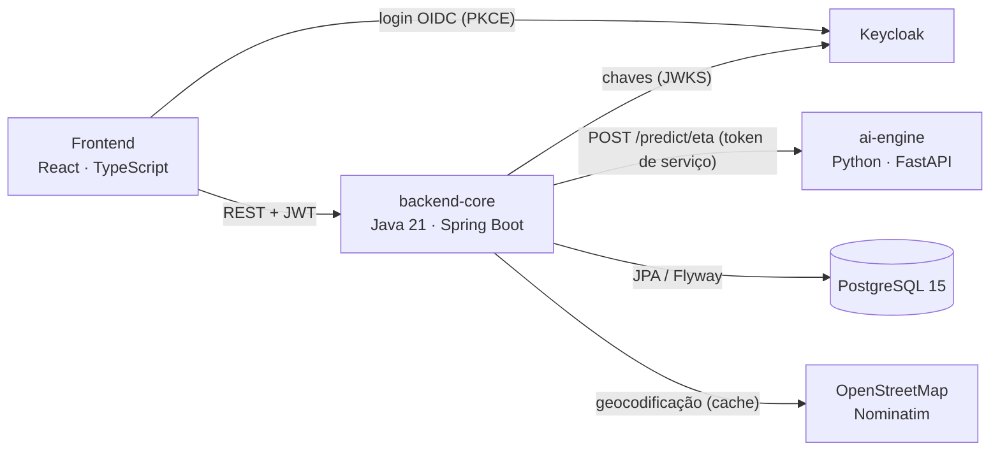

<div align="center">

# SmartRoute Logistics

**Despacho de cargas com previsão de chegada (ETA) por machine learning**

[](https://openjdk.org/projects/jdk/21/)
[](https://spring.io/projects/spring-boot)
[](https://www.python.org/)
[](https://fastapi.tiangolo.com/)
[](https://react.dev/)
[](https://www.typescriptlang.org/)
[](https://www.postgresql.org/)
[](https://github.com/carlosjc31/smartroute-logistics/actions/workflows/ci.yml)
[](LICENSE)

[Visão geral](#visão-geral) ·
[Arquitetura](#arquitetura) ·
[Primeiros passos](#primeiros-passos) ·
[API](#api) ·
[Modelo de ML](#modelo-de-machine-learning) ·
[Roadmap](#roadmap)

</div>

---

## Visão geral

O SmartRoute Logistics ajuda transportadoras a planejar e acompanhar entregas. A pessoa responsável pelo
despacho informa origem, destino, carga e horário de saída. O sistema localiza as cidades, estima a
duração da viagem com um modelo de machine learning e registra a viagem com a chegada prevista.

### Funcionalidades

- **Despacho com ETA inteligente.** A previsão considera distância, peso da carga e horário de pico.
- **Ciclo de vida da viagem.** Uma viagem pendente pode seguir para em trânsito ou ser cancelada; em
  trânsito, pode ficar atrasada ou ser concluída. As transições são validadas, e a chegada real fica
  registrada.
- **Geocodificação integrada.** Nomes de cidades viram coordenadas via OpenStreetMap, com cache e
  respeito à política de uso do provedor.
- **Tolerância a falhas.** Timeout, retry e circuit breaker na chamada ao serviço de IA. Se ele estiver
  indisponível, uma estimativa heurística é usada e sinalizada na interface.
- **Painel web.** Novo despacho, lista de viagens com filtros e paginação, e detalhe da viagem.
- **API documentada.** OpenAPI/Swagger e erros padronizados no formato
  [RFC 7807](https://datatracker.ietf.org/doc/html/rfc7807).
- **Segurança.** Login OIDC no Keycloak (PKCE), perfis de acesso, auditoria imutável, CORS restrito,
  rate limit e varreduras de segurança no CI. Detalhes em [`docs/seguranca.md`](docs/seguranca.md).

## Arquitetura



| Serviço | Stack | Responsabilidade |
|---|---|---|
| [`backend-core`](backend-core) | Java 21, Spring Boot 3.5, JPA, Flyway, Resilience4j | API de viagens, regras de negócio, orquestração da IA e persistência |
| [`ai-engine`](ai-engine) | Python 3.12, FastAPI, scikit-learn | Inferência de ETA com `RandomForestRegressor` |
| [`smartroute-frontend`](smartroute-frontend) | React 19, TypeScript, Vite, React Router, TanStack Query | Painel de despacho |

O `backend-core` é um **monólito modular** ([Spring Modulith](https://spring.io/projects/spring-modulith),
[ADR 0004](docs/adr/0004-monolito-modular.md)), com arquitetura hexagonal dentro de cada módulo:

```
trip/        Viagens e previsão de chegada (domain, application, infrastructure)   schema trip
geocoding/   Endereço → coordenadas pelo Nominatim, com cache                       sem tabelas
audit/       Auditoria append-only das alterações                                   schema audit
shared/      Coordenadas, paginação, segurança, erros HTTP (aberto a todos)
api/         Interfaces e DTOs gerados do contrato OpenAPI (aberto a todos)
```

As fronteiras são verificadas em teste: um módulo só usa a API pública de outro e não lê as tabelas dele.
Eventos entre módulos passam por um outbox no banco.

## Primeiros passos

### Pré-requisitos

- [Docker](https://docs.docker.com/get-docker/) e Docker Compose, para subir o ambiente completo
- Node.js 20.19+ ou 22.12+, para o frontend
- JDK 21, para desenvolver o backend fora do Docker (opcional)

### Ambiente completo com Docker

```bash
git clone https://github.com/carlosjc31/smartroute-logistics.git
cd smartroute-logistics
cp .env.example .env        # obrigatório: troque as senhas e tokens
docker compose up --build
```

Em outro terminal, suba o frontend:

```bash
cd smartroute-frontend
npm ci
npm run dev
```

| Serviço | Endereço |
|---|---|
| Painel web | http://localhost:5173 |
| API (backend-core) | http://localhost:8080/api/v1 |
| Swagger UI | http://localhost:8080/swagger-ui.html |
| Health check | http://localhost:8080/actuator/health |
| Keycloak (console e login) | http://localhost:8180 |
| Grafana | http://localhost:3000 |

Entre no painel com `despacho.dev` ou `admin.dev`, usando a senha definida em
`KEYCLOAK_DEV_USERS_PASSWORD`. O ai-engine e o PostgreSQL não ficam expostos no host: só o
backend-core os acessa, pela rede interna.

### Backend sem Docker

O backend pode rodar com um PostgreSQL embarcado, útil para desenvolvimento rápido. Os dados são
descartados ao encerrar.

```bash
docker compose up -d keycloak   # a API exige login; o Keycloak emite os tokens
cd backend-core
./mvnw spring-boot:test-run
```

### Configuração

As variáveis de ambiente ficam documentadas em [`.env.example`](.env.example). As principais:

| Variável | Descrição | Padrão (dev) |
|---|---|---|
| `SPRING_PROFILES_ACTIVE` | Perfil do backend (`dev` ou `prod`) | `dev` |
| `SPRING_DATASOURCE_URL` | URL JDBC do PostgreSQL | `jdbc:postgresql://localhost:5432/logistics_db` |
| `SPRING_DATASOURCE_USERNAME` / `_PASSWORD` | Credenciais do banco | valores locais de desenvolvimento |
| `AI_ENGINE_URL` | Endereço do ai-engine | `http://localhost:8000` |
| `AI_ENGINE_TOKEN` | Token de serviço backend → ai-engine (`SERVICE_TOKEN` no ai-engine) | obrigatório no `.env` |
| `OIDC_ISSUER_URI` / `OIDC_JWK_SET_URI` | Emissor dos tokens (Keycloak) e de onde vêm as chaves | `http://localhost:8180/realms/smartroute` |
| `CORS_ALLOWED_ORIGINS` | Origens do frontend autorizadas | `http://localhost:5173,http://localhost:4173` |
| `RATE_LIMIT_CAPACITY` | Requisições por minuto por usuário/IP | `120` |
| `GEOCODING_USER_AGENT` | Identificação exigida pelo Nominatim | `SmartRouteLogistics/0.1 (...)` |
| `GEOCODING_COUNTRY_CODES` | Países aceitos na busca de cidades | `br` |
| `VITE_API_URL` | Origem da API para o build do frontend | mesma origem |
| `VITE_OIDC_AUTHORITY` / `VITE_OIDC_CLIENT_ID` | Realm e client do login no frontend | `http://localhost:8180/realms/smartroute`, `smartroute-frontend` |

Nenhuma senha tem valor padrão versionado: o `docker compose` e o perfil `prod` se recusam a subir se
faltar alguma. Em produção, use um cofre de segredos ([`docs/seguranca.md`](docs/seguranca.md#segredos-30)).

## API

Base: `/api/v1`. A documentação interativa completa está no Swagger UI. Toda rota exige
`Authorization: Bearer <token>` do Keycloak, com perfil `DISPATCHER` ou `ADMIN`.

| Método | Rota | Descrição |
|---|---|---|
| `POST` | `/trips` | Cria uma viagem e calcula a chegada prevista |
| `GET` | `/trips?status=&page=&size=` | Lista viagens, das mais recentes para as mais antigas |
| `GET` | `/trips/{id}` | Detalha uma viagem |
| `PATCH` | `/trips/{id}/status` | Avança o status da viagem |
| `GET` | `/geocode?q=` | Converte o nome de uma cidade em coordenadas |
| `GET` | `/audit/trips/{id}` | Histórico de alterações da viagem: quem, quando, antes/depois (só `ADMIN`) |

<details>
<summary>Exemplo: criar uma viagem (valores ilustrativos)</summary>

```bash
# TOKEN: access token do Keycloak (no painel logado, fica no sessionStorage)
curl -X POST http://localhost:8080/api/v1/trips \
  -H "Authorization: Bearer $TOKEN" \
  -H "Content-Type: application/json" \
  -d '{
    "originLat": -23.5505, "originLng": -46.6333, "originLabel": "São Paulo",
    "destLat": -22.9068, "destLng": -43.1729, "destinationLabel": "Rio de Janeiro",
    "payloadWeight": 12,
    "departureTime": "2030-01-10T08:00:00-03:00"
  }'
```

```json
{
  "id": "53bda232-6a22-4302-8204-eb0e8a1680f7",
  "origin": { "label": "São Paulo", "lat": -23.5505, "lng": -46.6333 },
  "destination": { "label": "Rio de Janeiro", "lat": -22.9068, "lng": -43.1729 },
  "payloadWeight": 12.0,
  "distanceKm": 360.9,
  "status": "PENDING",
  "allowedTransitions": ["IN_TRANSIT", "CANCELLED"],
  "departureTime": "2030-01-10T08:00:00-03:00",
  "predictedArrival": "2030-01-10T15:10:00-03:00",
  "eta": { "source": "MODEL", "modelVersion": "v1.0-random-forest" },
  "actualArrival": null,
  "createdAt": "2026-11-22T10:11:11Z"
}
```

</details>

## Modelo de machine learning

O `ai-engine` usa um `RandomForestRegressor` treinado com um dataset **sintético** de 5.000 viagens,
gerado por [`training/generate_data.py`](ai-engine/training/generate_data.py):

| Variável | Efeito no tempo de viagem |
|---|---|
| Distância (km) | base, a 80 km/h |
| Peso da carga (t) | atraso proporcional |
| Hora de saída | ×1,5 nos horários de pico (7h–9h e 17h–19h) |
| Chuva | ×1,2 |

O treino ([`training/train_model.py`](ai-engine/training/train_model.py)) separa 20% dos dados para teste e reporta o erro
médio absoluto em minutos. Para retreinar:

```bash
cd ai-engine
python -m training.generate_data && python -m training.train_model
```

> O modelo atual serve para demonstração. O [roadmap](#roadmap) prevê o re-treino com as chegadas reais
> registradas pelo sistema, dados de clima e um intervalo de confiança real para a previsão.

## Testes

Cada serviço tem sua suíte, e o [CI](.github/workflows/ci.yml) roda todas em cada pull request:

| Camada | Ferramentas | Comando |
|---|---|---|
| Backend: unitários, controller, segurança e PostgreSQL embarcado | JUnit 5, Mockito, spring-security-test, zonky | `cd backend-core && ./mvnw test` |
| Backend: integração ponta a ponta com JWT real | Testcontainers (PostgreSQL), WireMock (ai-engine, Nominatim, JWKS) | `./mvnw verify` (exige Docker) |
| Backend: cobertura mínima de 80% no domínio, na aplicação e na API pública de cada módulo | JaCoCo | `./mvnw verify` |
| Backend: fronteiras entre módulos e regras hexagonais | Spring Modulith e ArchUnit | `./mvnw test` |
| ai-engine: API, token de serviço, hash do modelo e qualidade do modelo | pytest, TestClient | `cd ai-engine && pip install -r requirements-dev.txt && pytest` |
| Contrato backend ↔ ai-engine | exemplos em [`contracts/`](contracts) testados pelos dois lados | incluído nas suítes acima |
| Frontend: componentes e cliente da API | Vitest, Testing Library | `cd smartroute-frontend && npm test` |
| E2E: login → despacho → ETA → status → lista → logout | Playwright | `npm run e2e` (com o compose no ar) |
| Segurança: segredos, CVEs, SAST, DAST | gitleaks, Trivy, CodeQL, OWASP ZAP | [workflow `security.yml`](.github/workflows/security.yml) |

Para rodar o E2E localmente, suba o compose (`docker compose up`), execute
`npx playwright install chromium` uma vez e rode `E2E_PASSWORD=<KEYCLOAK_DEV_USERS_PASSWORD> npm run e2e`.

## Roadmap

A evolução do projeto está organizada em fases, acompanhadas pelas
[milestones do GitHub](https://github.com/carlosjc31/smartroute-logistics/milestones):

| Fase | Tema | Destaques |
|---|---|---|
| 0 | Fundação | Correções críticas, guia do repositório ✅ |
| 1 | Arquitetura e API | Hexagonal, Flyway, resiliência, API completa, frontend em TypeScript ✅ |
| 2 | Testes e CI | Testes de contrato, E2E, GitHub Actions ✅ |
| 3 | Segurança e LGPD | OAuth2/Keycloak, perfis de acesso, auditoria, varreduras de segurança ✅ · LGPD em andamento |
| R | Reestruturação | Spec-Driven Development e ADRs (R1), API contract-first (R2), monólito modular (R3), ai-engine e frontend por funcionalidade (R4) |
| 4 | Domínio logístico | Multi-tenant, frota, motoristas, pedidos, múltiplas paradas, rastreamento |
| 5 | Roteirização e ML | Rotas por estrada (OSRM), otimização (VRP), clima real, MLOps |
| 6 | Agentes de IA | Copiloto do despachante, agente de exceções, servidor MCP |
| 7 | Observabilidade e deploy | Métricas, tracing, dashboards, infraestrutura como código |

## Contribuindo

O projeto segue **Spec-Driven Development**: toda funcionalidade começa por uma especificação revisada
antes do código ([`specs/`](specs/README.md)), dentro dos princípios da [constituição](specs/constitution.md).
As decisões de arquitetura ficam em [`docs/adr/`](docs/adr/README.md).

1. Escolha ou abra uma [issue](https://github.com/carlosjc31/smartroute-logistics/issues).
2. Escreva ou atualize a spec em `specs/NNN-nome/` e aguarde a aprovação. Correções de bug que restauram
   um comportamento já especificado dispensam esta etapa.
3. Crie uma branch a partir de `main` no formato `tipo/descricao-curta` (`feat/`, `fix/`, `docs/`...).
4. Marque os testes com o requisito que cobrem (`// @req TRIP-001`) e rode
   `python3 scripts/check_spec_traceability.py`.
5. Use [Conventional Commits](https://www.conventionalcommits.org/pt-br/) e referencie a issue.
6. Abra um pull request descrevendo a mudança, os requisitos cobertos e como foi testado.

As convenções de código, a arquitetura e as regras de segurança estão em [`CLAUDE.md`](CLAUDE.md), que
também orienta agentes de IA que trabalham no repositório.

## Segurança

Autenticação, perfis, segredos, hardening e varreduras estão descritos em
[`docs/seguranca.md`](docs/seguranca.md). O mapeamento de dados pessoais (LGPD) fica em
[`docs/lgpd.md`](docs/lgpd.md). Nunca versione arquivos `.env` nem dados reais de clientes ou
motoristas. Para relatar uma vulnerabilidade, entre em contato diretamente com o mantenedor em vez de
abrir uma issue pública.

## Licença

Distribuído sob a licença MIT. Veja [`LICENSE`](LICENSE).

## Autor

**José Carlos Carneiro** · [LinkedIn](https://www.linkedin.com/in/jose-carlos-carneiro/)
