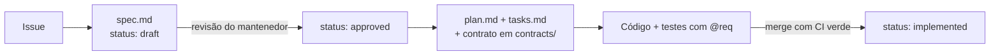

# Specs (Spec-Driven Development)

Cada funcionalidade do SmartRoute nasce de uma especificação versionada aqui, revisada antes do código.
Os princípios que valem para todas estão na [constituição](constitution.md). A decisão de adotar o
fluxo está na [ADR 0002](../docs/adr/0002-spec-driven-development.md).

## Estrutura

```
specs/
  constitution.md        princípios não negociáveis
  _templates/            modelos de spec.md, plan.md e tasks.md
  NNN-nome-curto/
    spec.md              O QUÊ e POR QUÊ: contexto, requisitos com ID, critérios de aceite
    plan.md              COMO: módulos, modelo de dados, contrato, segurança, riscos, ADRs
    tasks.md             passos pequenos, ordenados e verificáveis
```

`NNN` é sequencial e nunca reaproveitado. O prefixo dos requisitos (por exemplo `TRIP`) é único por spec
e declarado no cabeçalho dela.

## Fluxo



1. **Especificar.** Crie `specs/NNN-nome/spec.md` a partir do template (ou use a skill `/spec-new`).
   Abra um PR só com a spec, ou com a spec e o plano, para o mantenedor revisar.
2. **Aprovar.** Com a spec aprovada, o cabeçalho passa para `status: approved`.
3. **Planejar.** Escreva `plan.md` e `tasks.md` (skill `/spec-plan`). Mudança de API começa pelo
   contrato em `contracts/`. Decisões de arquitetura viram ADR em `docs/adr/`.
4. **Implementar.** Siga as tasks em ordem (skill `/spec-implement`). Todo teste que cobre um
   requisito leva o marcador `@req ID` em comentário.
5. **Concluir.** No PR que completa a implementação, o cabeçalho passa para `status: implemented`.

Mudou o comportamento depois? Atualize a spec no mesmo PR do código. A spec descreve o sistema como ele
é, não como era quando foi escrita.

## Status

| Status | Significado | O que o CI exige |
|---|---|---|
| `draft` | Em discussão | Só formato e IDs únicos |
| `approved` | Pode ser implementada | Formato; informa requisitos ainda sem teste |
| `implemented` | Em produção | Todo requisito não pendente tem teste com `@req` |
| `superseded` | Substituída por outra spec (indicada em `superseded_by`) | Só formato |

Requisitos podem ser marcados individualmente como `[pendente]` (aprovado, mas fica para uma etapa
futura) ou `[removido]` (mantém o ID para não ser reaproveitado).

## Rastreabilidade

Marque o teste com o ID do requisito em um comentário, em qualquer linguagem:

```java
// @req TRIP-004
@Test
void fallsBackToHeuristicWhenAiEngineIsDown() { ... }
```

```ts
// @req TRIP-020
it('oferece só as transições permitidas e envia a escolhida', async () => { ... })
```

```python
# @req ETA-001
def test_predicts_positive_duration(client, trip): ...
```

Verifique localmente:

```bash
python3 scripts/check_spec_traceability.py            # falha se faltar cobertura
python3 scripts/check_spec_traceability.py --report   # mostra requisito → testes
```

## Índice

| Spec | Prefixo | Status | Issues |
|---|---|---|---|
| [001 — Viagens e previsão de chegada](001-trips/spec.md) | `TRIP` | implemented | #3, #6–#8, #13–#16, #28, #35 |
| [002 — Geocodificação](002-geocoding/spec.md) | `GEO` | implemented | #20 |
| [003 — Inferência de ETA (ai-engine)](003-eta-inference/spec.md) | `ETA` | implemented | #9, #23, #24, #31 |
| [004 — Acesso, segurança e erros da API](004-api-security/spec.md) | `SEC` | implemented | #13, #28, #29 |
